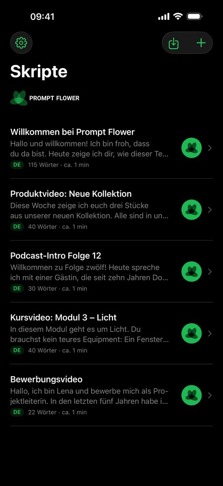
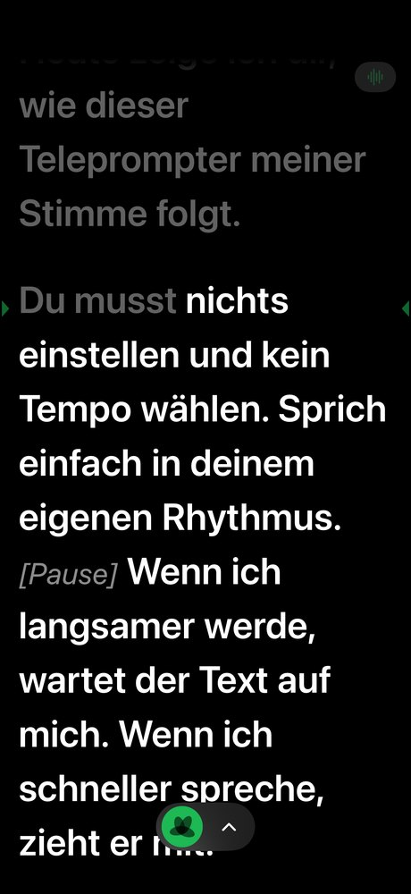
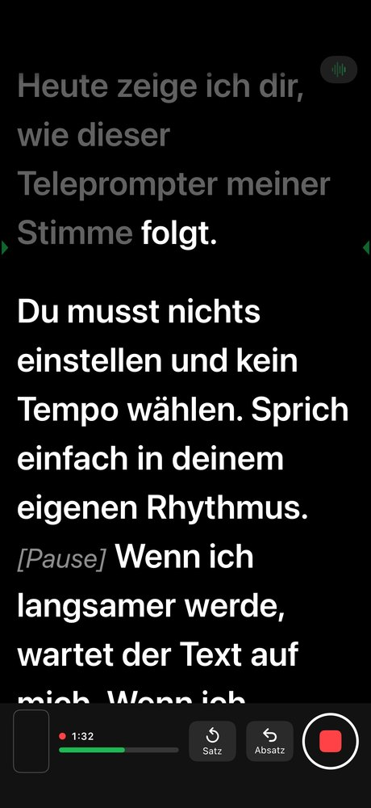
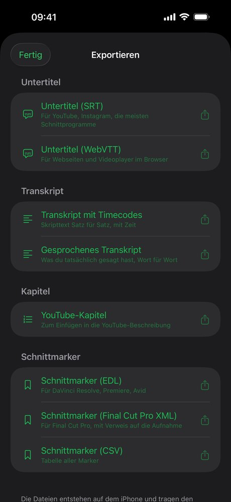


  
  
  
  


## Der Text folgt Deiner Stimme

Du sprichst, Prompt Flower liest mit. **Machst Du eine Pause, wartet der Text. Wirst Du schneller, zieht er mit.** Lässt Du einen Satz aus, findet er die Stelle wieder. Die Spracherkennung läuft auf dem iPhone, auf Deutsch und Englisch.

## So funktioniert es

Kein Pedal, kein Tempo, keine zweite Person.

1. **Text rein.** Schreib im Editor oder importiere Text, PDF oder Word. Regieanweisungen in eckigen Klammern wie `[Pause]` erscheinen gedimmt und werden beim Mitlesen übersprungen.
2. **Losreden.** Tipp auf die Blüte und sprich. Gelesene Wörter werden grau, die Lesezeile bleibt im oberen Drittel, nah an der Kamera. Ein Satz ging schief? „Satz zurück“ und noch mal.
3. **Aufnehmen und weiterverwenden.** Nimm Video oder nur Ton auf, gern mit Funk-Lavalier. Danach: Untertitel aus Deinem Skript, Marker für den Schnitt und ein Rohschnitt ohne die abgebrochenen Versuche.

## Aufnahme

Ein Knopf startet Aufnahme und Mitlesen. Der Text läuft direkt unter der Frontkamera, so bleibt Dein Blick nah an der Linse. Die Kamera-Vorschau ist klein und lässt sich per Tippen ausblenden.

- **Ton vom Funk-Lavalier:** Steck den Empfänger per USB-C oder Lightning an, Prompt Flower nimmt ihn automatisch. Abgezogen? Die Aufnahme läuft mit dem eingebauten Mikrofon weiter.
- **Video in 1080p oder 4K**, eine Datei mit Bild und Ton. Oder nur Ton, etwa für Podcasts und Sprechertexte.
- **Aufnahmen gehören zum Skript:** ansehen, mit Stern markieren, teilen, in Fotos sichern.

## Untertitel, Marker und Rohschnitt aus Deinem Skript

Der Text der Untertitel kommt aus Deinem Skript, richtig geschrieben. Das Timing kommt aus der Spracherkennung, Wort für Wort. Jedes „Satz zurück“ während der Aufnahme setzt einen Marker, und der Rohschnitt schneidet die abgebrochenen Versuche heraus. Du prüfst jeden Schnitt, das Original bleibt erhalten.

| Format | Wofür |
| --- | --- |
| SRT, WebVTT | Untertitel für YouTube, Instagram, Schnittprogramme und Webseiten |
| Transkript | Skripttext Satz für Satz mit Timecodes, oder was Du tatsächlich gesagt hast |
| Kapitel | YouTube-Kapitel aus Deinen Absätzen |
| EDL | Marker für DaVinci Resolve und Premiere Pro |
| FCPXML | Marker für Final Cut Pro |
| CSV | alle Marker als Tabelle |

## Fernsteuerung im Browser

Öffne die Fernsteuerung, und Prompt Flower zeigt einen QR-Code. Ein Tablet, ein Laptop oder ein zweites Handy im selben WLAN scannt ihn und steuert den Prompter im Browser: Start und Pause, Satz und Absatz vor und zurück, Tempo, Schriftgröße. Ohne App, ohne Internet, ohne Konto, geschützt durch einen Zugangscode, der mit „Beenden“ ungültig wird. Kostenlos, auch ohne Pro.

Dazu: Spiegelmodus für Teleprompter-Glas und Bluetooth-Clicker oder Tastatur.

## Datenschutz

Prompt Flower nutzt die Spracherkennung von iOS im reinen Gerätemodus. **Kein Ton und kein Text gehen ins Internet** – nicht zu mir, nicht zu Apple, nicht zu Dritten.

- **Kein Konto, keine Werbung, keine Analyse.** Im App Store steht: „Keine Daten erfasst“.
- **Fernsteuerung nur im WLAN**, Deine Geräte verbinden sich direkt miteinander.
- **Käufe über Apple.** Abo und Einmalkauf wickelt Apple ab; ich erhalte keine Zahlungsdaten.

Details in der [Datenschutzerklärung](/de/datenschutz/).

## Preise

| | Kostenlos | Prompt Flower Pro |
| --- | --- | --- |
| Skripte, Editor, Scrollen im festen Tempo, Fernsteuerung | ✓ | ✓ |
| Mitlesen mit der Stimme | 5 Minuten pro Tag | unbegrenzt |
| Aufnahme (Video und Ton) | – | ✓ |
| Untertitel, Transkripte, Schnittmarker, Rohschnitt | – | ✓ |
| **Preis** | **0 €** | **3,99 € pro Monat** oder **24,99 € pro Jahr**, je 7 Tage kostenlos testen – oder **59,99 € einmalig**, kein Abo |

Abos verlängern sich automatisch und sind jederzeit in den Einstellungen Deines Apple-Accounts kündbar. Maßgeblich sind die Preise im App Store.

## Häufige Fragen

**Welche Sprachen versteht Prompt Flower?**\
Deutsch und Englisch. Die Sprache stellst Du pro Skript ein.

**Brauche ich Internet?**\
Nein. Mitlesen, Aufnahme und Export funktionieren offline. Einmalig lädt iOS das Sprachpaket von Apple, falls es noch fehlt. Der Kauf von Pro läuft über den App Store.

**Welches Mikrofon brauche ich?**\
Zum Üben reicht das eingebaute Mikrofon. Für Aufnahmen empfehle ich ein Funk-Lavalier mit USB-C- oder Lightning-Empfänger; Prompt Flower wählt es automatisch. Bluetooth-Mikrofone nutzt die App nicht.

**Welche iPhones werden unterstützt?**\
iPhones mit iOS 17 oder neuer, im Hochformat. Für iPad gibt es Prompt Flower noch nicht.

**Was passiert, wenn die 5 Minuten aufgebraucht sind?**\
Der Text läuft im festen Tempo weiter, eine laufende Aufnahme wird nicht unterbrochen. Am nächsten Tag folgt der Text wieder 5 Minuten lang Deiner Stimme.

**Kann ich einen Angebotscode einlösen?**\
Ja, in der App unter Einstellungen › Code einlösen.

**Gibt es Prompt Flower für Android?**\
Geplant ist eine Beta über Google Play. [Melde Dich als Tester an](mailto:support@mitjamartini.com?subject=PromptFlower%20Android-Beta) – ich nutze Deine E-Mail-Adresse nur, um Dich zur Beta einzuladen.

## Support

E-Mail an [support@mitjamartini.com](mailto:support@mitjamartini.com?subject=PromptFlower), Antwort in der Regel am nächsten Werktag. Bitte nenne iPhone-Modell und iOS-Version.
