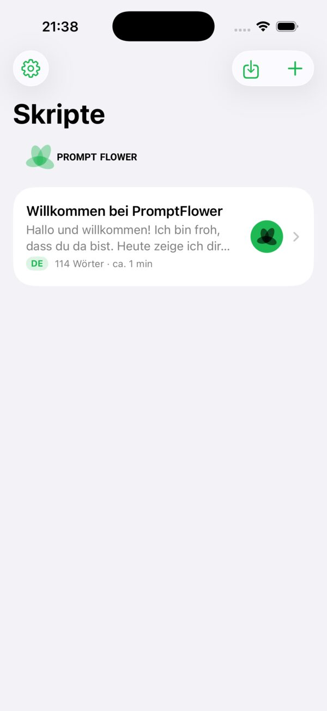
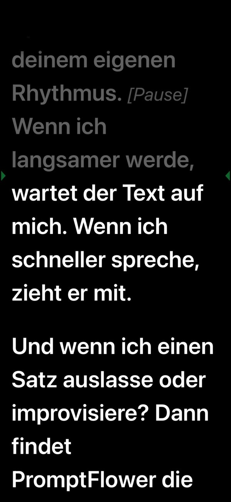
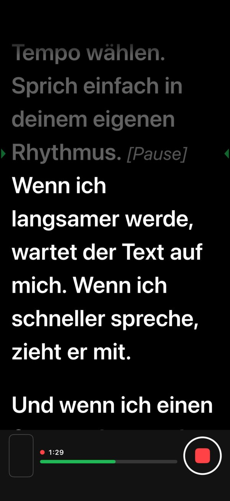
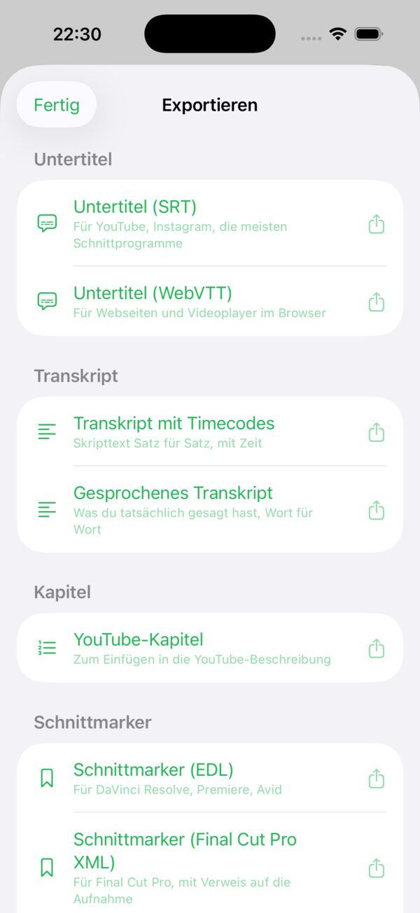


  
  
  
  


## So funktioniert es

1. **Text einfügen** oder importieren (TXT, PDF, Word). Regieanweisungen in eckigen Klammern wie `[Pause]` werden gedimmt angezeigt und beim Mitlesen übersprungen.
2. **Losreden.** Der Text läuft im Tempo Deiner Stimme mit, die aktuelle Zeile bleibt im oberen Drittel nah an der Kamera. Machst Du eine Pause, wartet der Text. Lässt Du einen Satz aus oder improvisierst, findet PromptFlower die Stelle wieder.
3. **Aufnehmen**, wenn Du willst: Video mit der Frontkamera oder nur Ton, am besten mit einem Ansteckmikrofon über USB-C oder Lightning. Ein Satz ging schief? „Satz zurück“ tippen und neu ansetzen.
4. **Weiterverwenden:** Untertitel (SRT, WebVTT) und Transkript mit der Schreibweise aus Deinem Skript, Schnittmarker für DaVinci Resolve, Premiere und Final Cut, und auf Wunsch ein Rohschnitt, der abgebrochene Versuche herausnimmt – das Original bleibt erhalten.

Dazu: Spiegelmodus für Teleprompter-Glas, Bluetooth-Clicker und -Pedale, und eine Fernsteuerung im Browser eines zweiten Geräts per QR-Code.

## Datenschutz

- **Alles auf dem Gerät.** Die Spracherkennung nutzt Apples Erkennung auf dem iPhone. Ton, Transkripte und Skripte werden nicht an mich oder Dritte übertragen.
- **Keine Konten, keine Werbung, kein Tracking.** Die App erhebt keine Nutzungsdaten.
- **Fernsteuerung nur im lokalen WLAN**, geschützt durch einen Einmal-Code im QR-Code.
- **Käufe über Apple.** Abo und Einmalkauf wickelt Apple ab; ich erhalte keine Zahlungsdaten.

Details in der [Datenschutzerklärung](/de/datenschutz/).

## Preise

Kostenlos: Skripte, Editor, Scrollen im festen Tempo, Fernsteuerung und **jeden Tag 5 Minuten Mitlesen mit der Stimme**.

**PromptFlower Pro** schaltet unbegrenztes Mitlesen, Aufnahmen, Untertitel, Transkripte, Schnittmarker und den Rohschnitt frei:

| Variante | Preis |
| --- | --- |
| Monatlich | 3,99 € pro Monat, mit 7 Tagen kostenlos testen |
| Jährlich | erstes Jahr 19,99 €, danach 29,99 € pro Jahr |
| Einmalkauf | 59,99 € |

Abos verlängern sich automatisch und sind jederzeit in den Einstellungen Deines Apple-Accounts kündbar. Maßgeblich sind die Preise im App Store.

## Häufige Fragen

**Welche Sprachen versteht PromptFlower?**\
Deutsch und Englisch. Der Text folgt Dir auch bei langen deutschen Wörtern und Zahlen.

**Brauche ich Internet?**\
Nein. Mitlesen, Aufnahme und Export funktionieren offline. Nur der Kauf von Pro läuft über den App Store.

**Welches Mikrofon?**\
Das eingebaute Mikrofon reicht zum Üben. Für Aufnahmen empfehle ich ein Ansteckmikrofon (kabellos mit USB-C- oder Lightning-Empfänger); PromptFlower wählt es automatisch.

**Gibt es PromptFlower für Android?**\
Bald als Beta über Google Play. [Melde Dich als Tester an](mailto:support@mitjamartini.com?subject=PromptFlower%20Android-Beta) – ich nutze Deine E-Mail-Adresse nur, um Dich zur Beta einzuladen.

## Support

E-Mail an [support@mitjamartini.com](mailto:support@mitjamartini.com?subject=PromptFlower), Antwort in der Regel am nächsten Werktag. Bitte nenne iPhone-Modell und iOS-Version.
