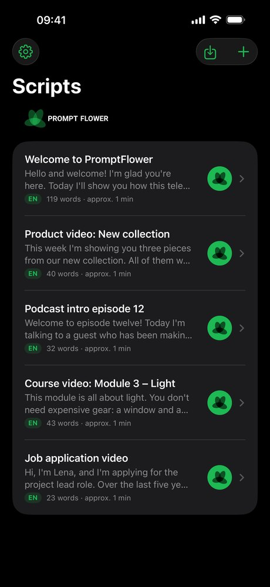
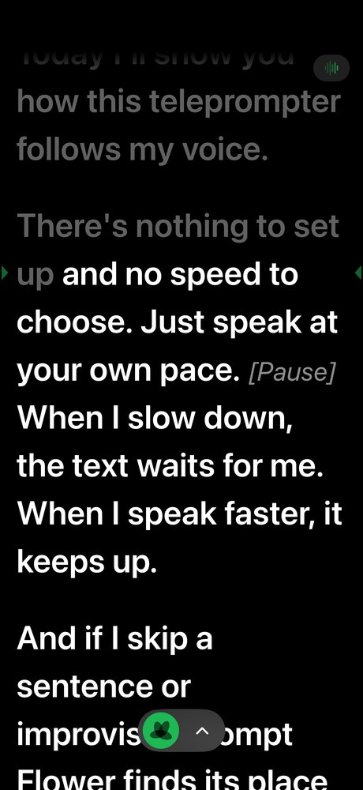
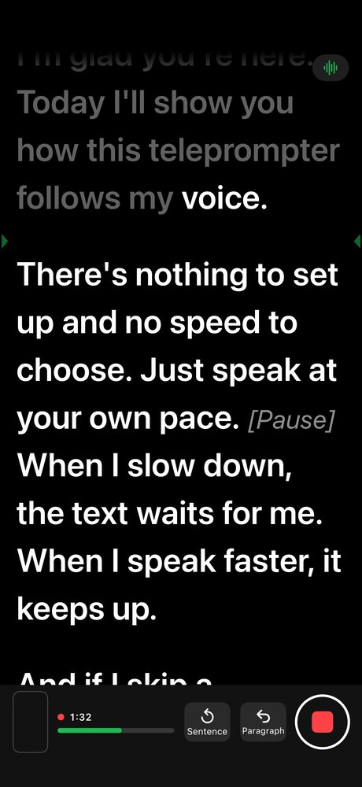
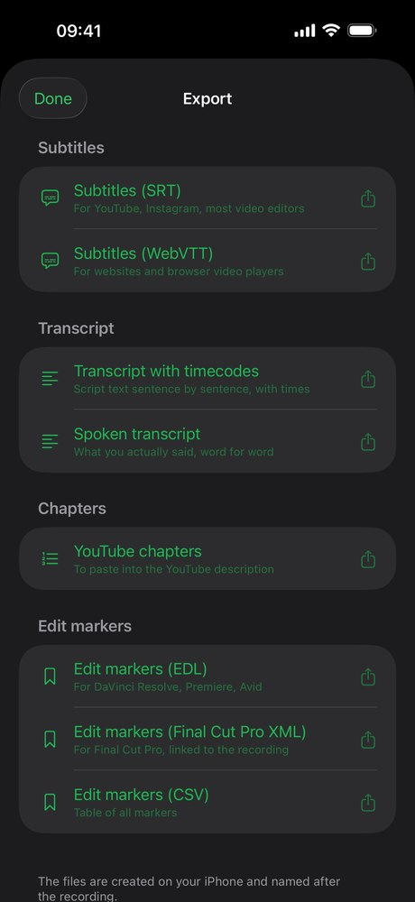


  
  
  
  


## The script follows your voice

You speak, PromptFlower reads along. **Pause and the script waits. Speed up and it keeps up.** Skip a sentence and it finds its place again. Speech recognition runs on the iPhone, in English and German.

## How it works

No pedal, no speed setting, no second person.

1. **Add your script.** Write in the editor or import text, PDF or Word. Stage directions in square brackets such as `[Pause]` are dimmed and skipped while following.
2. **Start talking.** Tap the flower and speak. Read words turn grey and the reading line stays in the upper third, close to the camera. Fluffed a sentence? Tap "Sentence back" and go again.
3. **Record and reuse.** Record video or audio only, ideally with a wireless lavalier. Afterwards: subtitles from your script, edit markers and a rough cut without the abandoned attempts.

## Recording

One button starts recording and voice following. The script runs right below the front camera, so your eyes stay close to the lens. The camera preview is small and can be hidden with a tap.

- **Sound from a wireless lavalier:** plug the receiver in via USB-C or Lightning and PromptFlower uses it automatically. Unplugged? Recording continues with the built-in microphone.
- **Video in 1080p or 4K**, one file with picture and sound. Or audio only, for podcasts and voice-overs.
- **Takes belong to the script:** watch, star, share, save to Photos.

## Subtitles, markers and rough cut from your script

The subtitle text comes from your script, spelled right. The timing comes from speech recognition, word by word. Every "Sentence back" during a take sets a marker, and the rough cut removes the abandoned attempts. You review every cut; the original stays untouched.

| Format | For |
| --- | --- |
| SRT, WebVTT | subtitles for YouTube, Instagram, editors and websites |
| Transcript | the script sentence by sentence with timecodes, or what you actually said |
| Chapters | YouTube chapters from your paragraphs |
| EDL | markers for DaVinci Resolve and Premiere Pro |
| FCPXML | markers for Final Cut Pro |
| CSV | all markers as a table |

## Remote control in the browser

Open the remote and PromptFlower shows a QR code. A tablet, laptop or second phone on the same Wi-Fi scans it and controls the prompter in the browser: start and pause, sentence and paragraph back and forward, speed, font size. No app, no internet, no account, protected by an access code that stops working when you tap "Stop". Free, even without Pro.

Plus: mirror mode for teleprompter glass and Bluetooth clickers or keyboards.

## Privacy

PromptFlower uses iOS speech recognition in on-device-only mode. **No audio and no text go to the internet** – not to me, not to Apple, not to third parties.

- **No account, no ads, no analytics.** The App Store says "Data Not Collected".
- **Remote control on your Wi-Fi only**, your devices connect directly.
- **Purchases through Apple.** Apple handles subscriptions and the one-time purchase; I receive no payment details.

Details in the [privacy policy](/en/privacy/).

## Pricing

| | Free | PromptFlower Pro |
| --- | --- | --- |
| Scripts, editor, fixed-speed scrolling, remote control | ✓ | ✓ |
| Voice following | 5 minutes a day | unlimited |
| Recording (video and audio) | – | ✓ |
| Subtitles, transcripts, edit markers, rough cut | – | ✓ |
| **Price** | **€0** | **€3.99 per month** or **€24.99 per year**, each with a 7-day free trial – or **€59.99 one-time**, no subscription |

Subscriptions renew automatically and can be cancelled at any time in your Apple account settings. Prices in the App Store apply.

## FAQ

**Which languages does PromptFlower understand?**\
English and German. You set the language per script.

**Do I need internet?**\
No. Following, recording and export work offline. iOS downloads the speech package from Apple once if it's missing. Buying Pro goes through the App Store.

**Which microphone do I need?**\
The built-in microphone is fine for practice. For recordings I recommend a wireless lavalier with a USB-C or Lightning receiver; PromptFlower picks it automatically. The app doesn't use Bluetooth microphones.

**Which iPhones are supported?**\
iPhones with iOS 17 or later, in portrait. There's no iPad version yet.

**What happens when the 5 minutes are used up?**\
The script continues at a fixed speed and a running recording isn't interrupted. The next day the script follows your voice for 5 minutes again.

**Can I redeem an offer code?**\
Yes, in the app under Settings › Redeem Code.

**Is there an Android version?**\
A beta on Google Play is planned. [Sign up as a tester](mailto:support@mitjamartini.com?subject=PromptFlower%20Android%20beta) – I only use your e-mail address to invite you to the beta.

## Support

E-mail [support@mitjamartini.com](mailto:support@mitjamartini.com?subject=PromptFlower), usually answered the next working day. Please include your iPhone model and iOS version.
