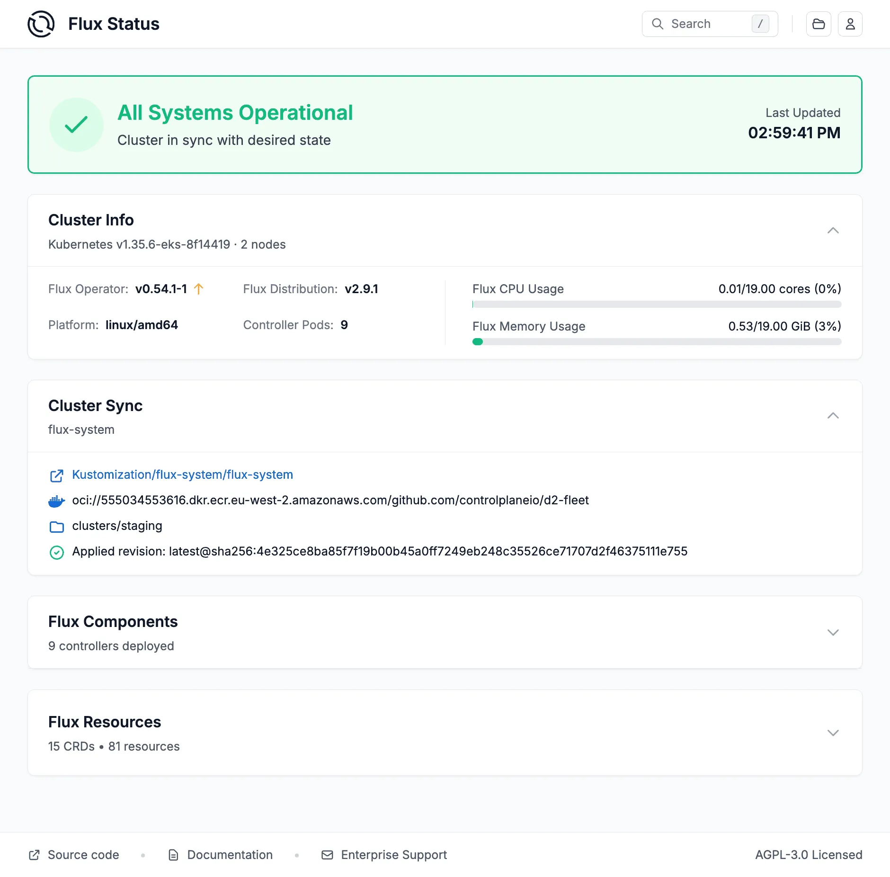
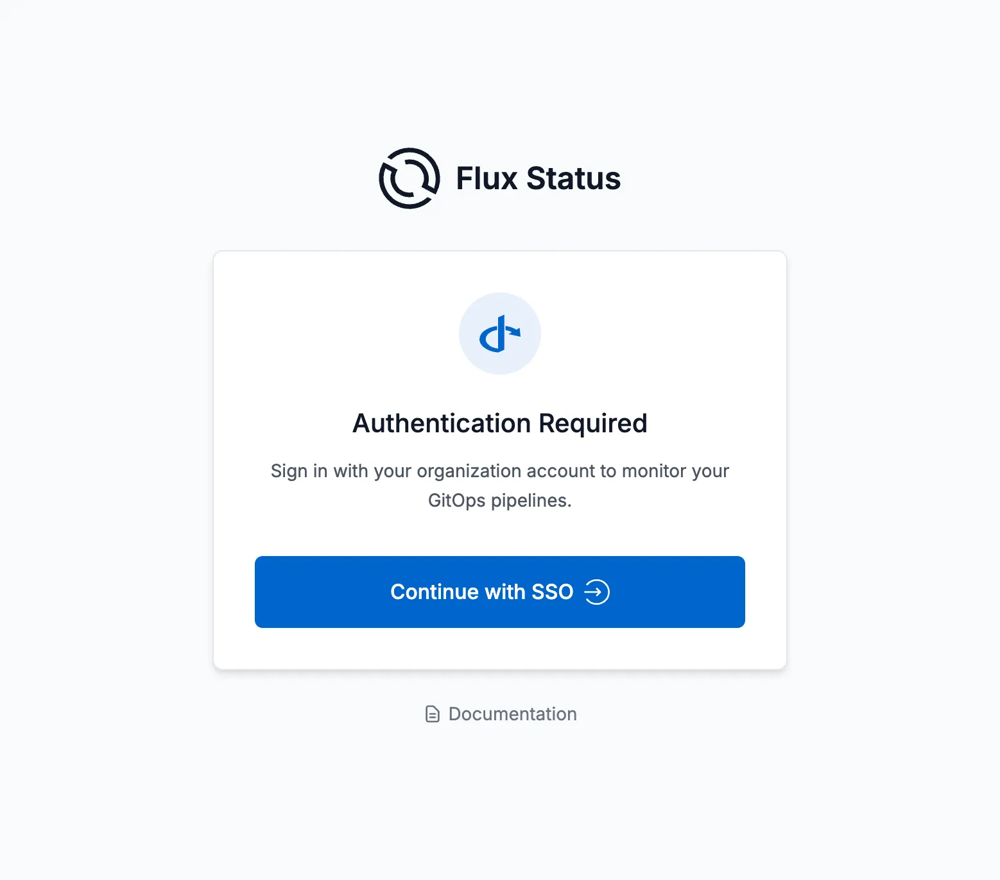
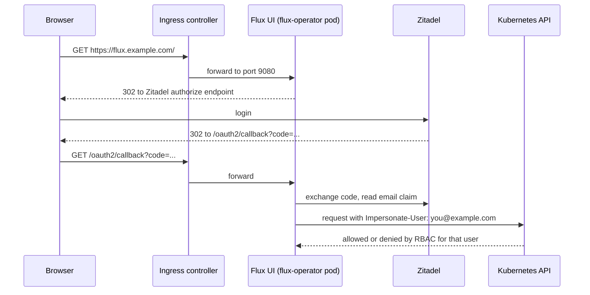
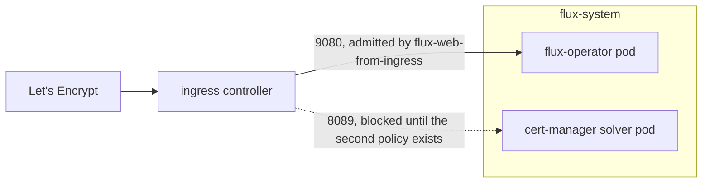
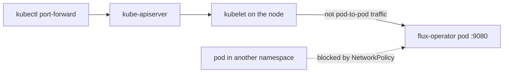

When you install the [Flux Operator](https://fluxoperator.dev) with its Helm chart, you also install and start its web UI, on port 9080, without authentication. It reads with the operator's ServiceAccount, which is `cluster-admin`, and the chart's NetworkPolicy admits every namespace. So any pod in the cluster can read everything Flux knows: the inventory of every app, the specs of every Kustomization and HelmRelease including their values, and the pod templates of every workload Flux manages, environment variables included. Without authentication the UI does not act, so the buttons to reconcile, suspend and resume are not there. The quickest way to get them, `Anonymous` authentication with a named identity, hands them to every pod as well.



*The dashboard view. Screenshot from the Flux Operator project's own site, fluxoperator.dev, not from my instance.*

With the help of Claude Code I built a small Kustomize package, `flux-web-sso`, that closes this and reaches the UI either through an ingress or through `kubectl port-forward`. Its site-specific values sit in one file:

- `kustomization.yaml` holds every value (user, role, operator version, host, ingress class, issuer) and reaches the manifests through `replacements`. Commenting out one line switches between the two setups:
  - Setup A: an ingress, cert-manager and a public hostname.
  - Setup B: `kubectl port-forward` only.
- `base/flux-operator.yaml`: an OCIRepository and a HelmRelease for the operator, with the chart's NetworkPolicy turned off.
- `base/rbac.yaml`: a `flux-web-viewer` role that cannot read Secrets, and the binding for your user.
- `components/ingress/exposure.yaml`: Certificate, Ingress and the two NetworkPolicies Setup A needs, including the one for the ACME solver.
- `web-config.example.yaml`: the OIDC config as a Secret, applied separately so the file you edit never contains the client secret.

There is also a [kind demo](https://github.com/mitja/blog-code/tree/main/2026-09-flux-operator-web-ui-with-zitadel-sso/kind-demo) that shows the default, the shortcut and the fix from a pod in another namespace, and the same as a step-by-step [Educates workshop](https://github.com/mitja/blog-code/tree/main/2026-09-flux-operator-web-ui-with-zitadel-sso/educates). I checked everything below against chart versions 0.59.0 and 0.61.0.

What surprised me and what I learned along the way:

1. **Without a web config the UI is read-only.** Reconcile, suspend, resume, restart, pod deletion, logs and artifact downloads are all off until authentication is configured. What it gives out is reading, as cluster-admin, to every pod. Secrets themselves it does not serve, only Flux objects and the workloads Flux manages; a password written into HelmRelease values or a Deployment's environment it does.
2. **Native OIDC with impersonation beats a proxy.** I wanted oauth2-proxy; Claude recommended the UI's own OIDC login. With impersonation every action is checked by the API server as the signed-in person, so RBAC decides.
3. **Removing the chart's NetworkPolicy is the fix**, but only because Flux's own baseline policies in `flux-system` admit same-namespace traffic only. Where Flux runs without them, removing it opens the UI to everyone.
4. **Port-forward is a real access model.** It goes through the API server and the kubelet, not pod to pod, so NetworkPolicy does not apply. The kubeconfig opens the tunnel, OIDC says who is signed in, and RBAC decides what they may do.
5. **The callback path `/oauth2/callback` is not documented.** Claude found it with `strings` on the operator binary.
6. **Zitadel leaves the email out of the ID token by default.** Password and second factor succeed, Zitadel logs nothing, and the operator fails with `no such key: email`. The fix is "User Info inside ID Token" on the application, and the email must be verified.
7. **The "read-only" `flux-web-user` role may read every Secret** (`apiGroups: ["*"], resources: ["*"]`). The UI does not show them, but the identity may read them wherever it reaches the API server.
8. **`flux-web-admin` is close to cluster-admin**, because `create jobs` and `patch deployments` run arbitrary images. That is not a bug; it is what "restart workloads" means once spelled out. RBAC cannot say "everything except Secrets", so a safe viewer has to list what it may read.
9. **The certificate did not issue, and it was not DNS.** The ingress controller could not reach cert-manager's short-lived solver pod (port 8089) because of the namespace policy, and the 502 was the clue. Fixed by hand, the renewal fails the same way months later.
10. **Small traps:** an 18-digit client ID left unquoted loses its last digits; `${VAR}` inside YAML comments still gets substituted and can break a strict build; an empty UI after a successful login means a missing or mismatched RBAC binding; and over plain http some browsers drop the UI's `Secure` cookies unless the config says `insecure: true`.

The rest of this post covers four things: closing the network path the chart leaves open, turning on the UI's native OpenID Connect login so that it reads and acts as the signed-in person instead of as cluster-admin, what the chart's RBAC roles actually let that person do, and two ways of reaching the UI afterwards. The first is the usual one: an ingress controller and a public hostname. The second is `kubectl port-forward`, which I use on a cluster where I do not want to add an ingress at all. The identity provider in the examples is Zitadel, but nothing here is Zitadel-specific beyond the console screens.

## What the chart opens, and how to close it

The chart ships a NetworkPolicy for the operator pod. It is hardcoded to

```yaml
ingress:
  - from:
      - namespaceSelector: {}
```

which admits every namespace, and there is no Helm value to narrow it. Any pod in any namespace can therefore reach a console on port 9080 that reads as cluster-admin and asks nobody for a login.

### What a pod in another namespace sees

The UI's browser talks to a JSON API on the same port, and that API answers anyone who reaches it. From a pod in another team's namespace, with no token and no cookie, in the [kind demo](https://github.com/mitja/blog-code/tree/main/2026-09-flux-operator-web-ui-with-zitadel-sso/kind-demo):

```sh
UI=http://flux-operator.flux-system:9080
curl -s $UI/api/v1/resources                                                  # every Flux object, with its status
curl -s "$UI/api/v1/resource?kind=HelmRelease&namespace=shop&name=shop-api"   # the spec, values included
curl -s "$UI/api/v1/workload?kind=Deployment&namespace=shop&name=shop-api-podinfo"  # the pod template, env included
```

A password written into the HelmRelease's values came back twice, once in `.spec.values` and once in the Deployment's environment. What the API does not give out: Secrets (`unable to find Flux kind Secret`), objects Flux does not manage, pod logs, artifact downloads and every action. A `POST /api/v1/resource/action` to suspend a Kustomization answers `User actions are disabled`, and the code says why: user actions are enabled exactly when authentication is configured. So the default is a leak, not a takeover. For an attacker it is the map of the cluster, plus whatever was written into specs.

### The shortcut that makes it a takeover

The buttons are missing, and the quickest way to get them is a web config with `Anonymous` authentication and a fixed identity:

```yaml
spec:
  authentication:
    type: Anonymous
    anonymous:
      username: flux-ui
```

Bind `flux-ui` to the chart's `flux-web-admin` and the buttons work, for everyone who reaches port 9080. In the demo the pod in the other namespace then suspended the shop's Kustomization and deleted its pods through `/api/v1/resource/action` and `/api/v1/workload/action`, and the audit events said `User 'flux-ui' performed action 'suspend'`: a trail that names nobody. The fix below takes the other way, a login per person.

### Closing the network path

The fix is to turn that policy off and not write a replacement:

```yaml
# values for the flux-operator chart
web:
  networkPolicy:
    create: false
```

Flux's own baseline policies in `flux-system` already do the right thing, provided they exist. `allow-egress` selects every pod in the namespace and admits ingress from `podSelector: {}`, which means pods in the same namespace only, on all ports. `allow-scraping` admits all namespaces on port 8080 so metrics keep working. NetworkPolicies are additive: a pod is reachable if any policy that selects it admits the traffic. Removing the chart's policy removes only its allowance.

| Policy | Selects | Admits | Ports |
|---|---|---|---|
| chart `flux-operator` policy (removed) | operator pod | every namespace | 9080 |
| `allow-egress` (Flux baseline) | all pods in `flux-system` | same-namespace pods | all |
| `allow-scraping` (Flux baseline) | all pods in `flux-system` | every namespace | 8080 |

Net effect: port 9080 is reachable from inside `flux-system`, metrics scraping is untouched, and cross-namespace access to the UI is gone. Whatever you add for your own access path goes on top of this.

Check that the baseline is there before you switch the chart's policy off:

```sh
kubectl -n flux-system get networkpolicy
```

A `FluxInstance` writes `allow-egress`, `allow-scraping` and `allow-webhooks` when `cluster.networkPolicy` is `true`, which is its default. Without them, the operator pod is selected by no policy at all once the chart's is gone, and a pod no policy selects is reachable from everywhere. Then you need a policy of your own in place of the chart's, not none.

## Native SSO instead of a proxy

My first instinct was oauth2-proxy in front of the UI. The Flux UI supports OIDC directly, and that is the better option here, not just the simpler one. A proxy authenticates at the door and then forwards to a backend that still runs with its own full privileges. The Flux UI instead impersonates the signed-in user into a Kubernetes identity. A reconcile or suspend clicked in the browser is executed as that person, and the API server checks it against normal RBAC. There is nothing to bypass by talking to the backend directly, because the backend does not act on its own behalf.



*The login screen once OAuth2 is configured. Screenshot from the Flux Operator project's own site, fluxoperator.dev, not from my instance.*

The configuration is a `Config` document. The chart accepts it inline as `web.config`, or as `web.configSecretName` naming a Secret with a `config.yaml` key. Since it contains the client secret, use the Secret:

```yaml
apiVersion: v1
kind: Secret
metadata:
  name: flux-web-config
  namespace: flux-system
stringData:
  config.yaml: |
    apiVersion: web.fluxcd.controlplane.io/v1
    kind: Config
    spec:
      baseURL: https://flux.example.com
      authentication:
        type: OAuth2
        oauth2:
          provider: OIDC
          issuerURL: https://accounts.example.com
          clientID: "123456789012345678"
          clientSecret: "..."
          impersonation:
            username: "claims.email"
      userActions:
        access: Impersonated
        audit: ["*"]
```

```yaml
# values for the flux-operator chart
web:
  enabled: true
  configSecretName: flux-web-config
  networkPolicy:
    create: false
```

Two details about the shape. `impersonation` nests under `authentication.oauth2`, not directly under `authentication`; so do `variables`, `validations` and `profile`. And `Anonymous` is not what you get without any config. Without a config there is no authentication at all and the UI is read-only; `Anonymous` is the shortcut from above, a configured identity that everyone shares.

`impersonation.username: "claims.email"` means the `email` claim of the ID token becomes the Kubernetes username. Everything in RBAC hangs off that string.

### The callback path

The OAuth2 callback path is `/oauth2/callback`, so the redirect URI you register at the identity provider is `<baseURL>/oauth2/callback`. This is not in the upstream documentation as of this writing. I found it by running `strings` on the operator binary. If your provider rejects the redirect after login, this is the first thing to check.

### Identity provider setup

In Zitadel, create an application in your project:

- Type: Web
- Authentication method: Code
- Grant types: Authorization Code and Refresh Token
- Redirect URI: `<baseURL>/oauth2/callback`
- Post-logout URI: `<baseURL>/`
- Token settings: "User Info inside ID Token" enabled

If the `baseURL` is `http://localhost:9080` (the port-forward setup below), Zitadel requires "dev mode" on the application, because it refuses plain-HTTP redirect URIs otherwise.

The token setting is the one that cost me time. Zitadel puts the profile and email claims on the userinfo endpoint by default and leaves them out of the ID token. The Flux UI reads its claims from the ID token. With the setting off, the password and the second factor are accepted, Zitadel logs no error, and the operator logs:

```
failed to process claims from OIDC ID token: failed to evaluate impersonation
username expression: failed to evaluate the CEL expression 'claims.email':
no such key: email
```

The ID token in that state carried `amr`, `at_hash`, `aud`, `auth_time`, `azp`, `client_id`, `exp`, `iat`, `iss`, `nonce`, `sid` and `sub`. No `email`, no `name`. The scope was not the problem; the authorize URL the UI builds requests `openid offline_access profile email groups`. Turning on "User Info inside ID Token" on the application fixes it. Nothing in the cluster changes.

The user's email must also be verified in Zitadel. An unverified email can be left out of the token even with that setting on, and the result is the same: a login that succeeds and then matches no RBAC binding.

## RBAC: who the signed-in user is allowed to be

With `web.rbac.createRoles` left at its default of `true`, the chart creates three ClusterRoles:

| ClusterRole | Verbs | Meaning |
|---|---|---|
| `flux-web-user` | get, list, watch | read only |
| `flux-web-edit` | read plus patch | edit resources, no lifecycle actions |
| `flux-web-admin` | read plus reconcile, suspend, resume, patch, restart | full operation of the Flux installation |

That is the ladder the names suggest. The actual rules are wider, which the next two subsections cover.

You bind an identity to one of them. Upstream documents binding a Group, which is the right model for a team. If your provider does not emit a groups claim, or you have not set one up, bind a plain `User` whose name is exactly what `impersonation.username` produces:

```yaml
apiVersion: rbac.authorization.k8s.io/v1
kind: ClusterRoleBinding
metadata:
  name: flux-web-admin-you
subjects:
  - kind: User
    name: you@example.com
    apiGroup: rbac.authorization.k8s.io
roleRef:
  kind: ClusterRole
  name: flux-web-admin
  apiGroup: rbac.authorization.k8s.io
```

The symptom of a missing binding is easy to recognise: the login completes, the UI loads, and it shows nothing. No error, just an empty console. Check the binding's subject name against the email in your ID token.

### What the roles actually grant

I read the rules off a running cluster with `kubectl get clusterrole -o yaml`. `flux-web-user` is:

```yaml
- apiGroups: ["*"]
  resources: ["*"]
  verbs: ["get", "list", "watch"]
```

`flux-web-admin` is that, plus:

```yaml
- apiGroups: [the seven Flux API groups]
  resources: ["*"]
  verbs: ["patch", "reconcile", "suspend", "resume", "download"]
- apiGroups: ["apps"]
  resources: ["deployments", "statefulsets", "daemonsets"]
  verbs: ["patch", "restart"]
- apiGroups: ["batch"]
  resources: ["cronjobs", "jobs"]
  verbs: ["create", "restart"]
- apiGroups: [""]
  resources: ["pods"]
  verbs: ["delete"]
```

Two consequences.

"Read only" may read every Secret in the cluster. `resources: ["*"]` in every API group includes Secrets, in every namespace. `kubectl auth can-i get secrets --as=you@example.com -n any-namespace` returns `yes` for a user bound to `flux-web-user`. The UI itself does not show Secrets, so through the UI this stays theoretical. It stops being theoretical wherever the same identity reaches the API server another way, for example when the cluster trusts the same OIDC provider for kubectl, or when the role gets reused for something else. On a cluster where SOPS decrypts registry tokens, S3 credentials and database passwords into Secrets, that identity may read all of them.

`flux-web-admin` is close to cluster-admin in practice. `create jobs` runs an arbitrary image as an arbitrary ServiceAccount, and `patch deployments` does much the same. That is not a fault in the role. It is what "restart my workloads" means once you spell it out. But it should not come as a surprise when you hand the binding out.

I checked with SubjectAccessReviews for a user bound to `flux-web-admin`:

| check | result |
|---|---|
| patch Flux Kustomizations | yes |
| patch Deployments | yes |
| create Jobs | yes |
| delete Pods | yes |
| create Deployments | no |
| delete Kustomizations | no |
| create ClusterRoleBindings | no |
| delete Secrets | no |

One more thing to say plainly: do not bind your user to `cluster-admin` as a shortcut. The point of the impersonation setup is that the API server checks the signed-in person. Binding cluster-admin gives the UI back the unrestricted power the setup removed, with a login page in front of it.

### A viewer role that cannot read Secrets

RBAC has no way to say "everything except Secrets", so a narrower viewer has to enumerate what it may read. This is the one I bind for a second person:

```yaml
apiVersion: rbac.authorization.k8s.io/v1
kind: ClusterRole
metadata:
  name: flux-web-viewer
rules:
  - apiGroups: ["fluxcd.controlplane.io", "source.toolkit.fluxcd.io", "source.extensions.fluxcd.io",
                "kustomize.toolkit.fluxcd.io", "helm.toolkit.fluxcd.io", "image.toolkit.fluxcd.io",
                "notification.toolkit.fluxcd.io"]
    resources: ["*"]
    verbs: ["get", "list", "watch"]
  - apiGroups: [""]
    resources: ["pods", "pods/log", "events", "services", "namespaces", "persistentvolumeclaims", "configmaps"]
    verbs: ["get", "list", "watch"]
  - apiGroups: ["apps"]
    resources: ["deployments", "statefulsets", "daemonsets", "replicasets"]
    verbs: ["get", "list", "watch"]
  - apiGroups: ["batch"]
    resources: ["jobs", "cronjobs"]
    verbs: ["get", "list", "watch"]
  - apiGroups: ["events.k8s.io"]
    resources: ["events"]
    verbs: ["get", "list", "watch"]
```

Checked the same way: `get secrets` is denied; listing Kustomizations, HelmReleases, Deployments and Events and reading pod logs are allowed; `patch kustomizations` is denied.

I also signed in as a user bound to it, in the demo: the UI lists Flux objects and shows HelmReleases and Deployments, and a suspend is refused with `Permission denied. User bob@example.com does not have access to suspend Kustomization/shop/podinfo`. Panels that show data derived from Secrets, such as a source's authentication status, may show less or show an error. I make it the default for anyone who is not operating Flux.

What no role fixes: a viewer may read HelmReleases, so a password written into a HelmRelease's values, or rendered into a Deployment's `env`, is readable for every viewer. Put it in a Secret and reference it with `secretKeyRef`; then the UI shows the reference, not the value. `valuesFrom` a Secret helps less than it looks, because Helm renders the value into the Deployment and the UI shows the Deployment's environment.

## Setup A: ingress controller and a public hostname

This is the setup for a cluster that already runs an ingress controller and cert-manager. The request path looks like this:



Three manifests, all in `flux-system`, plus a fourth that I only found out I needed when the certificate would not issue.

A Certificate from cert-manager:

```yaml
apiVersion: cert-manager.io/v1
kind: Certificate
metadata:
  name: flux-web-tls
  namespace: flux-system
spec:
  secretName: flux-web-tls
  dnsNames:
    - flux.example.com
  issuerRef:
    name: letsencrypt-prod
    kind: ClusterIssuer
```

An Ingress pointing at the `flux-operator` Service on port 9080:

```yaml
apiVersion: networking.k8s.io/v1
kind: Ingress
metadata:
  name: flux-web
  namespace: flux-system
spec:
  ingressClassName: nginx
  tls:
    - hosts:
        - flux.example.com
      secretName: flux-web-tls
  rules:
    - host: flux.example.com
      http:
        paths:
          - path: /
            pathType: Prefix
            backend:
              service:
                name: flux-operator
                port:
                  number: 9080
```

And a NetworkPolicy that admits only the ingress controller's namespace to port 9080. This is the first allowance you add on top of the Flux baseline:

```yaml
apiVersion: networking.k8s.io/v1
kind: NetworkPolicy
metadata:
  name: flux-web-from-ingress
  namespace: flux-system
spec:
  podSelector:
    matchLabels:
      app.kubernetes.io/name: flux-operator
  policyTypes:
    - Ingress
  ingress:
    - from:
        - namespaceSelector:
            matchLabels:
              kubernetes.io/metadata.name: ingress-nginx
      ports:
        - port: 9080
          protocol: TCP
```

The DNS record for `flux.example.com` has to exist and point at the ingress controller before cert-manager can complete the HTTP-01 challenge. If you commit all of this in one go and the Certificate sits in a pending state, that is one reason. The other is the NetworkPolicy you just wrote.

### The ACME solver needs its own NetworkPolicy

My certificate did not issue, and because the DNS record was minutes old I spent the first while blaming propagation. It was not propagation. `dig` answered correctly the whole time.

cert-manager answers an HTTP-01 challenge by creating a throwaway solver pod in the Certificate's namespace, here `flux-system`, and routing `/.well-known/acme-challenge/...` on the hostname to it. The Flux baseline `allow-egress` policy selects every pod in `flux-system` and admits ingress only from pods in the same namespace. The policy above admits the ingress controller to the operator pod on 9080 and to nothing else. So the ingress controller could route the challenge path to the solver pod but could not connect to it, and the public challenge URL returned 502. cert-manager reported `Waiting for HTTP-01 challenge propagation: wrong status code '502', expected '200'`.



The tell is in that message. A 502 is the ingress controller failing to reach a backend. A name that does not resolve fails differently. I confirmed it by curling the solver pod's IP from a pod in the ingress controller's namespace: connection refused, exit code 7.

The fix is a second policy. cert-manager labels its solver pods itself, and the port is fixed at 8089:

```yaml
apiVersion: networking.k8s.io/v1
kind: NetworkPolicy
metadata:
  name: acme-http-solver-from-ingress
  namespace: flux-system
spec:
  podSelector:
    matchLabels:
      acme.cert-manager.io/http01-solver: "true"
  policyTypes:
    - Ingress
  ingress:
    - from:
        - namespaceSelector:
            matchLabels:
              kubernetes.io/metadata.name: ingress-nginx
      ports:
        - port: 8089
          protocol: TCP
```

After applying it the challenge URL returned 200, the challenge went `valid`, and the order completed within seconds.

Two things follow. The solver pod exists only for the seconds a challenge takes, so the policy has to be in place before the challenge starts. If you fix this once by hand instead of in your manifests, the renewal will fail the same way a couple of months later, when you have forgotten this. And it is not specific to Flux. Any Certificate issued into a namespace whose pods sit under a same-namespace-only ingress policy hits it, because HTTP-01 needs the solver reachable from the ingress controller. DNS-01 does not, and is the way out if you have many hosts and do not want to write this policy for each of them.

## Setup B: no ingress, kubectl port-forward

On one of my clusters the only ingress is Gardener's istio, and Gardener manages it. Adding a public hostname for the Flux UI there means either entangling with that controller or running a second ingress controller for a single service. I wanted neither, so the UI is reached with

```bash
kubectl -n flux-system port-forward svc/flux-operator 9080:9080
```

and then opened at `http://localhost:9080`. The config differs from Setup A in two lines, `baseURL: http://localhost:9080` and `insecure: true`, and the Zitadel application gets `http://localhost:9080/oauth2/callback` as its redirect URI with dev mode on. There is no Ingress, no Certificate, and no NetworkPolicy allowance of any kind.

`insecure: true` drops the `Secure` flag from the UI's cookies. Chrome and Firefox accept `Secure` cookies on `http://localhost` anyway; Safari does not, loses the login state on the way back from the provider, and the UI says "Authentication failed" with nothing in the operator's log. Over https, leave it out.

That last point is what makes this work. `kubectl port-forward` is not affected by NetworkPolicy, because the traffic does not arrive as pod-to-pod traffic. It goes from kubectl to the API server, from the API server to the kubelet on the node where the pod runs, and from the kubelet into the pod over the node's own network namespace.



I measured this rather than taking it on trust. With a deny-all-ingress NetworkPolicy on a test pod, a curl from another pod failed with exit code 7 (connection refused), while a port-forward to the same pod returned 200. So you can close port 9080 to every other pod and still reach the UI yourself, and only with a kubeconfig that is allowed to port-forward into `flux-system`.

This is a legitimate setup, not a workaround. The kubeconfig gates who can open the tunnel, the OIDC login gates who is signed in once the tunnel is open, and RBAC gates what that person may do. Actions stop running as cluster-admin, which was the actual problem.

## The two setups side by side

| | Setup A: ingress | Setup B: port-forward |
|---|---|---|
| `baseURL` | `https://flux.example.com` | `http://localhost:9080`, with `insecure: true` |
| Ingress | yes | no |
| Certificate | yes, cert-manager | no |
| Extra NetworkPolicies | two: ingress controller namespace to 9080, and to the ACME solver on 8089 | none |
| How it is reached | browser to public hostname | `kubectl port-forward` |
| What gates network access | ingress controller, NetworkPolicy | kubeconfig with port-forward rights |
| What authenticates the user | OIDC via Zitadel | OIDC via Zitadel (dev mode for localhost) |
| What the actions run as | impersonated user | impersonated user |
| Exposed to | the internet, behind SSO | nothing outside the tunnel |

## The whole thing as a Kustomize package

Everything above is packaged so you do not have to reassemble it out of prose:
**[flux-web-sso](https://github.com/mitja/blog-code/tree/main/2026-09-flux-operator-web-ui-with-zitadel-sso/flux-web-sso)**
in the blog-code repository. It is the configuration running on my clusters, with the site-specific
values lifted into one file. It assumes Flux's own NetworkPolicies in `flux-system` (see above), and
it hands the operator to Flux: if you installed the chart with `helm install`, the helm-controller
takes over the release `flux-system/flux-operator` and upgrades it with the package's values.

```
kustomization.yaml            the values, and the Setup A / Setup B switch — edit this
web-config.example.yaml       the OIDC config Secret; applied separately, carries a secret
base/
  flux-operator.yaml          OCIRepository + HelmRelease, chart NetworkPolicy off
  rbac.yaml                   flux-web-viewer ClusterRole + the binding for your user
components/
  ingress/exposure.yaml       Setup A: Certificate, Ingress, and two NetworkPolicies
```

The values sit at the top of [`kustomization.yaml`](https://github.com/mitja/blog-code/blob/main/2026-09-flux-operator-web-ui-with-zitadel-sso/flux-web-sso/kustomization.yaml) and are the
only thing to edit:

```yaml
literals:
  - user=you@example.com
  - role=flux-web-viewer
  - operatorVersion=0.59.0
  # Setup A only
  - host=flux.example.com
  - ingressClassName=nginx
  - ingressNamespace=ingress-nginx
  - clusterIssuer=letsencrypt-prod
```

They reach the manifests through Kustomize `replacements`, and the ConfigMap holding them is
annotated `config.kubernetes.io/local-config: "true"` so it configures the build without being
applied to the cluster.

Switching between the two setups is one line. Setup A is the default; for Setup B, comment out the
component:

```yaml
components:
  - components/ingress      # comment out for port-forward only
```

Kustomize tolerates replacement targets that match nothing, so the Setup A values can stay in the
file unused. Then:

```sh
cp web-config.example.yaml /tmp/web-config.yaml
$EDITOR /tmp/web-config.yaml          # baseURL, issuerURL, clientID, clientSecret (+ insecure for Setup B)
kubectl apply -f /tmp/web-config.yaml && rm /tmp/web-config.yaml

$EDITOR kustomization.yaml
kubectl apply -k .
```

The Secret is applied separately and on purpose. It carries the client secret, and keeping it out
of the kustomization means the file you edit and might commit never contains one. If you do keep
this in Git with Flux, encrypt it with SOPS and add it to the resources list.

A further step this package does not take: `web.serverOnly: true` runs the UI as a Deployment of
its own, in a second Helm release, whose ServiceAccount may read everything and impersonate users
but is not cluster-admin. With impersonation the difference is small; without authentication it is
the difference between reading as cluster-admin and reading as a viewer.

## Gotchas

**Quote the client ID.** Zitadel client IDs are 18-digit numbers. Unquoted in YAML they parse as integers, and somewhere in the chain a float64 round-trip drops the last digits. I got `expected string, got 123456789012345678` from a client ID that did not end in `78`. Write `clientID: "123456789012345678"`, with quotes, every time.

**Variable substitution reads comments.** If the config passes through a tool that does variable substitution, such as Flux's `postBuild.substitute` or envsubst, a `${VAR}` reference inside a YAML comment is substituted too. I had a comment mentioning a variable that did not exist in the substitution map, and under strict mode that failed the whole kustomization build. Either define the variable or do not mention it, even in a comment.

**Empty UI after a successful login.** Covered above, but it deserves repeating because it looks like a bug in the UI rather than in your RBAC. Login works, nothing is listed. The impersonated username has no binding, or the binding's subject does not match the email claim exactly.

**The identity provider says yes, the UI says no.** Zitadel accepts the password and the second factor and logs nothing wrong, and the operator fails with `no such key: email`. The provider is not where the fault is. The UI wants the claim in the ID token, and Zitadel puts it on the userinfo endpoint unless "User Info inside ID Token" is on for the application. When a login fails after a clean authentication, read the operator log and the token contents, not the provider's log.

**Authentication failed over plain http.** The login at the provider succeeds, the UI says "Authentication failed", and the operator logs nothing. The UI's login state cookie is `Secure`, and a browser that does not send `Secure` cookies to `http://localhost` (Safari) loses it on the way back. Set `insecure: true` for Setup B.

**A 502 on the ACME challenge is not DNS.** If the Certificate is pending and cert-manager reports `wrong status code '502'`, the ingress controller resolved the name and could not reach the solver pod. Check NetworkPolicy before checking propagation.

## Summary

With its defaults, the chart runs a UI that every pod in the cluster can reach, that reads as cluster-admin and asks nobody for a login. It does not act, but it shows everything Flux knows, including whatever was written into specs and values, and the quickest way to make its buttons work, `Anonymous` with a named identity, hands those to every pod too. After this: the chart's NetworkPolicy is gone and Flux's baseline policies limit port 9080 to `flux-system` (check that they exist first); the UI signs users in through OIDC and impersonates them, so every read and every action goes through RBAC as a named person; and you reach it either through an ingress with two narrow NetworkPolicy allowances, one for the UI and one for the ACME solver, or through `kubectl port-forward` with no allowance at all. The callback path is `/oauth2/callback`, Zitadel has to be told to put the email claim in the ID token, the client ID is a string, comments are not safe from substitution, and plain http needs `insecure: true`. And read the chart's roles before you bind them: the read-only one may read every Secret, the admin one can run arbitrary Jobs, a viewer that cannot read Secrets has to be written by hand, and no role protects a password written into a spec.
